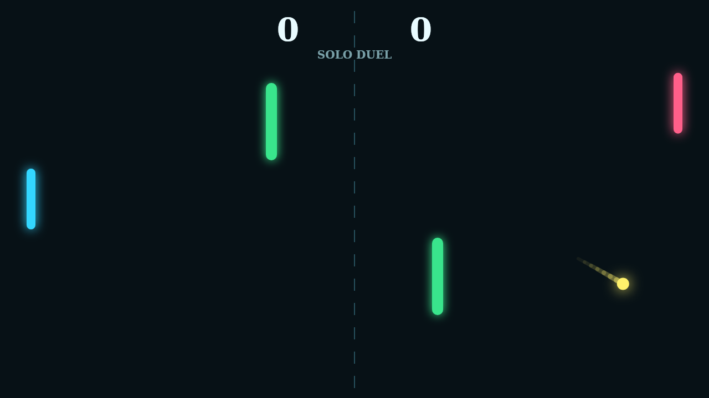

# Carom

Carom is a fast paddle duel played on a clean neon court. The first serve comes
in straight enough to read, but the rally quickly opens up as the ball glances
off walls, paddles, and the two green bars anchored near midfield.

The heart of each point is spin. Move a paddle through the hit and the ball
starts bending after it leaves, turning a simple return into a curling shot that
can slip past a waiting opponent.

Those fixed obstacles make the center of the field dangerous and useful at the
same time. A safe return can become a banked angle, and a desperate block can
send the ball arcing back through traffic.

Play Solo against the right-side AI or Versus with two players on one keyboard.
Matches run to 11, but close games keep going until someone wins by two.
